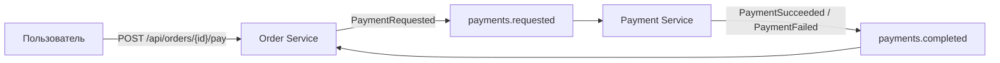

# microservices

## Part 2 · Асинхронная оплата через Kafka

Работают четыре сервиса из part 1, каждый со своей PostgreSQL.

| Сервис | Ответственность | Swagger |
| --- | --- | --- |
| auth-service | Регистрация, вход и профиль | [8081](http://localhost:8081/swagger/index.html) |
| catalog-service | Товары и корзина | [8082](http://localhost:8082/swagger/index.html) |
| order-service | Заказы, цены на момент покупки и статус | [8084](http://localhost:8084/swagger/index.html) |
| payment-service | Имитация оплаты | [8083](http://localhost:8083/swagger/index.html) |



Создание заказа сохраняет данные синхронно через REST и возвращает `201`.
`POST /api/orders/{id}/pay` записывает запрос оплаты в outbox и возвращает
`202 Accepted`, пока заказ ожидает результат. Фоновый издатель отправляет
`PaymentRequested` через Kafka. Платёжный сервис сохраняет платёж и событие
результата в одной транзакции. Заказ обновляет статус на `PAID` или
`PAYMENT_FAILED` после получения результата через Kafka.

| Топик | Ключ | Партиции | Группа потребителей |
| --- | --- | --- | --- |
| `payments.requested` | UUID заказа | 3 | `payment-workers` |
| `payments.completed` | UUID заказа | 3 | `order-payment-results` |

JSON содержит `eventId`, `eventType`, `occurredAt`, `aggregateId` и `payload`.
Сумма передаётся целым числом в центах. Повтор запроса оплаты использует
одну запись outbox на заказ, а повтор события использует тот же платёж.
Потребители подтверждают offset после обработки в своей БД.

### Запуск

В PowerShell из корня репозитория:

```powershell
powershell.exe -NoProfile -ExecutionPolicy Bypass -File .\start.ps1
```

Скрипт собирает приложения, запускает PostgreSQL и Kafka, применяет миграции
и запускает сервисы. Kafka доступна на `localhost:9092`, внутри Compose — на
`kafka:29092`.

### Покупка через Swagger

1. Зарегистрируйтесь через `POST /api/register`, вызовите `POST /api/login`
   и скопируйте токен.
2. Создайте товар через `POST /api/products` с телом
   `{"name":"Клавиатура","price":49.90}`. Скопируйте его ID.
3. В Swagger заказов нажмите **Authorize** и введите `Bearer <токен>`.
   Вызовите `POST /api/orders` с телом
   `{"items":[{"product_id":1,"quantity":2}]}`, подставив свой ID товара.
4. Вызовите `POST /api/orders/{id}/pay` с UUID заказа. Затем
   `GET /api/orders/{id}` покажет итоговый статус после обработки события.

### Проверка отложенной оплаты

```powershell
powershell.exe -NoProfile -ExecutionPolicy Bypass -File .\smoke-test.ps1
```

Проверка останавливает `payment-service`, дважды отправляет запрос оплаты
и подтверждает, что Kafka приняла его. После запуска сервиса заказ переходит
в `PAID`, а платёж с исходной ценой существует в единственном экземпляре.
Для нулевой суммы проверяется `PAYMENT_FAILED`. Скрипт выводит метаданные Kafka.
Контейнеры остаются запущенными, тестовые записи сохраняются.

```powershell
docker compose exec kafka /opt/kafka/bin/kafka-topics.sh --bootstrap-server kafka:29092 --describe --topic payments.requested
docker compose exec kafka /opt/kafka/bin/kafka-topics.sh --bootstrap-server kafka:29092 --describe --topic payments.completed
docker compose logs payment-service order-service
```
