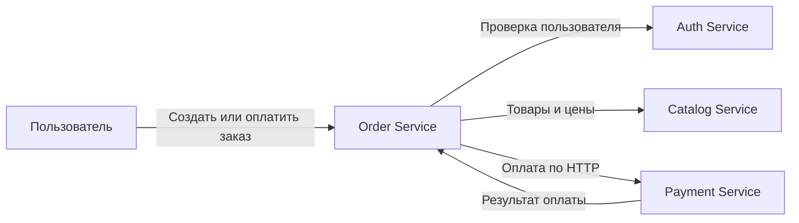

# microservices

Учебный репозиторий по курсу микросервисов.

## part1

Первая лаба: четыре Go-сервиса со своими базами PostgreSQL и Swagger. Заказы обращаются к другим сервисам по HTTP.

- `auth-service` — авторизация/регистрация пользователей
- `catalog-service` — каталог товаров + корзина
- `payment-service` — оплата
- `order-service` — оформление заказа, фиксация цен и состояние оплаты



Каталог хранит актуальные товары и цены. Заказ хранит, кто и что заказал,
названия товаров, цены на момент оформления и статус оплаты. В part 2
HTTP-вызов оплаты и обработку его результата можно заменить публикацией запроса
на оплату и обработкой результата из Kafka. Хранилище заказов и снимки цен
при этом уже существуют.

Подробности по каждому сервису (эндпоинты, переменные окружения) — в README внутри его директории.

### Запуск всех сервисов

```powershell
docker compose build
docker compose up -d --wait auth-db catalog-db payment-db order-db
docker compose run --rm auth-service migrate
docker compose run --rm catalog-service migrate
docker compose run --rm payment-service migrate
docker compose run --rm order-service migrate
docker compose up -d --wait
```

После старта:

- auth-service: <http://localhost:8081/swagger/index.html>
- catalog-service: <http://localhost:8082/swagger/index.html>
- payment-service: <http://localhost:8083/swagger/index.html>
- order-service: <http://localhost:8084/swagger/index.html>

### Как купить товар через Swagger

1. В Swagger авторизации вызовите `POST /api/register`, затем `POST /api/login`
   с теми же данными. Скопируйте поле `token`.
2. В Swagger каталога вызовите `POST /api/products` с телом
   `{"name":"Клавиатура","price":49.90}`. Скопируйте `id` товара.
3. В Swagger заказов нажмите **Authorize** и введите `Bearer <токен>`.
   Вызовите `POST /api/orders` с телом
   `{"items":[{"product_id":1,"quantity":2}]}`, подставив свой ID товара.
   Заказ вернётся со статусом `PENDING_PAYMENT`.
4. Передайте UUID заказа в `POST /api/orders/{id}/pay`. При успешной оплате
   заказ перейдёт в `PAID`. `GET /api/orders/{id}` показывает его состояние.

Список позиций передаётся явно. Корзина остаётся в каталоге и сохраняет своё
содержимое после покупки. Складского учёта в этой версии нет.

### Проверка через Compose

Из корня проекта в PowerShell выполните `./smoke-test.ps1`. Скрипт проверяет
регистрацию, корзину, оформление заказа при остановленном сервисе платежей,
повтор оплаты после его запуска и сохранение исходной цены после изменения
товара в каталоге. Контейнеры остаются запущенными, тестовые записи остаются в БД.

### Работа с базой

SQL-запросы находятся в `internal/repository.go` каждого сервиса. Бизнес-логика
авторизации и расчёта статуса платежа находится в `internal/service.go`.
Команда `migrate` применяет миграции из `internal/migrations/` к БД сервиса
и записывает применённые версии в `schema_migrations`. Выполняйте её перед
первым запуском и после обновлений, меняющих схему. Начальная миграция
поддерживает базы, созданные старой версией приложения. Для изменения схемы
добавляйте новый SQL-файл с очередным номером, например `002_add_index.sql`.

### Запуск одного сервиса локально (без Docker)

Нужен запущенный Postgres, см. `DATABASE_URL` по умолчанию в README сервиса.

```bash
cd auth-service
go run . migrate
go run .
```
